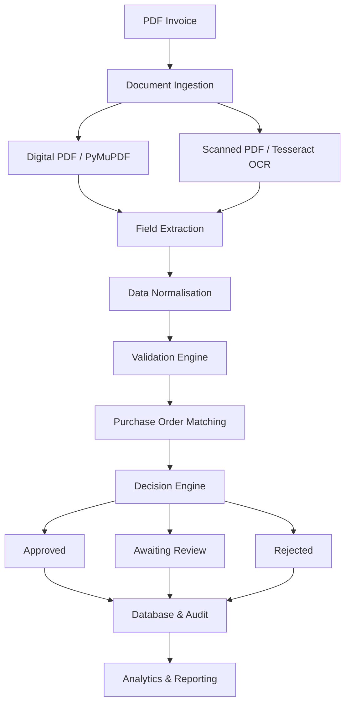

# InvoiceFlow
### Explainable Invoice Processing & Approval System

[](https://adithya-invoiceflow.streamlit.app)
[](https://python.org)
[](https://streamlit.io)
[](https://sqlite.org)

**Live Application:** https://adithya-invoiceflow.streamlit.app

## Overview

InvoiceFlow is a modular accounts payable processing system that converts unstructured vendor invoices into validated, traceable financial decisions.

It combines PDF text extraction, OCR, structured field normalisation, deterministic validation rules and purchase order reconciliation into a unified processing pipeline. Each invoice is evaluated against configurable procurement and financial constraints before being assigned an approval status.

The system supports automated decision making while retaining human oversight through review queues, administrative overrides and an auditable decision history.

## Core Features

| Module | Functionality |
|---|---|
| Document Extraction | PDF parsing, scanned-document OCR, optional Gemini extraction |
| Validation Engine | Missing-field, duplicate, date, tax and arithmetic checks |
| PO Reconciliation | Vendor matching, balance validation, split-PO and cumulative overrun detection |
| Decision Engine | Risk scoring, blocking conditions, approval routing and decision rationale |
| Invoice Management | Approved, Awaiting Review and Rejected registers |
| Analytics | Vendor-wise expenditure, approval metrics and risk distribution |
| Administration | Vendor permissions, PO management, configurable tolerances and status overrides |
| Audit | Administrative activity logs and decision history |

## Architecture



## Technology Stack

| Technology | Application |
|---|---|
| Python | Core processing and business logic |
| Streamlit | Web application interface |
| Custom CSS | UI styling and theme management |
| PyMuPDF | PDF text extraction |
| Tesseract OCR | Scanned invoice processing |
| Pillow | Image processing |
| Google Gemini | Optional AI-assisted extraction |
| Pandas | Data processing and analytics |
| SQLite | Record and configuration storage |

## Validation & Edge Cases

| Scenario | Expected outcome |
|---|---|
| Valid invoice with matching PO | Approved |
| Scanned invoice with missing PO | Review / Rejection |
| Multiple invoices against one PO | Cumulative balance validation |
| Duplicate invoice with renamed file | Rejected |
| Unapproved vendor | Blocked / Rejected |
| Mathematical or tax mismatch | Flagged for review |

Additional checks include future-dated invoices, missing fields, changed bank details, credit notes and PO price or quantity variances.

## Installation

**Requirements:** Python 3.11+, pip and Tesseract OCR.

```bash
git clone https://github.com/adoshkit/Invoice_Flow.git
cd Invoice_Flow

python -m venv venv
source venv/bin/activate

pip install -r requirements.txt
streamlit run app.py
```

On Ubuntu, install OCR support using:

```bash
sudo apt install tesseract-ocr
```

## Project Structure

```text
Invoice_Flow/
├── app.py
├── db.py
├── pipeline.py
├── extract_common.py
├── extract_rules.py
├── extract_gemini.py
├── theme.py
├── colours.txt
├── requirements.txt
├── requirements-gemini.txt
├── packages.txt
├── test_demo.py
├── make_samples.py
└── samples/
```

## Configuration

- `colours.txt` — Customisable sRGB HEX colour tokens.
- Admin interface — Vendor permissions, purchase orders and workflow tolerances.
- Extraction settings — Offline rules-based or optional Gemini extraction.

## Data & Security

- SQLite stores invoice records, vendor data, purchase orders and audit events.
- Administrator controls govern vendor permissions and invoice status overrides.
- Sample invoices are intended for demonstration and testing.
- Production use requires persistent database infrastructure, secure authentication and appropriate access controls.

---

**Repository:** https://github.com/adoshkit/Invoice_Flow  
**Live Demo:** https://adithya-invoiceflow.streamlit.app
